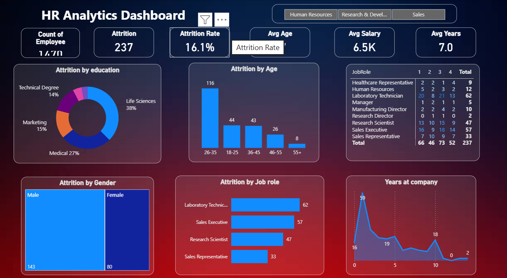

# HR Analytics Dashboard

## Project Overview

An interactive HR Analytics Dashboard built using Power BI to analyze employee attrition, workforce trends, job roles, education, gender, age, salary, and years at the company.

## Tools Used

- Power BI
- Data Analysis
- Data Cleaning
- Data Visualization

## Dashboard Features

- Employee count
- Attrition count and attrition rate
- Average age
- Average salary
- Average years at company
- Attrition by education
- Attrition by age
- Attrition by gender
- Attrition by job role
- Years at company analysis

## Dashboard Preview

## Project Files

- `HR analytics Dashboard.pbix` — Power BI dashboard file
- `HR_Dashboard.png` — Dashboard preview

## Key Insights

The dashboard provides an interactive view of employee attrition patterns and workforce characteristics to support HR-related data analysis and decision-making.
